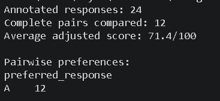

# AI Response Evaluation & Quality Assessment Framework

A Python-based framework for evaluating and comparing AI-generated responses using a structured, multi-dimensional quality assessment approach.

## Project Overview

This project evaluates two AI-generated responses to the same prompt and identifies the stronger response based on predefined quality criteria.

It uses a structured annotation dataset and a Python-based scoring engine to assess response quality, compare alternatives, flag potential hallucinations, and generate evaluation reports.

## Key Features

- **Multi-dimensional Evaluation:** Evaluates responses across five dimensions.
- **Quality Scoring:** Assigns scores from 1–5 for each evaluation criterion.
- **Pairwise Comparison:** Compares two responses and identifies the higher-scoring response.
- **Hallucination Flagging:** Records potentially fabricated or unsupported claims.
- **Automated Reporting:** Generates CSV reports and evaluation summaries.
- **Label Randomization:** Randomizes A/B response labels to reduce positional bias.
- **Custom Dataset Support:** Allows users to add their own prompts and responses through a structured CSV file.

## Evaluation Criteria

| Criterion | Description |
|---|---|
| Factual Accuracy | Correctness of information |
| Relevance | Alignment with the given prompt |
| Completeness | Coverage of required information |
| Instruction Adherence | Compliance with user instructions |
| Clarity | Readability and presentation |

Each criterion is scored from 1 to 5.

The five scores are equally weighted to calculate an overall quality score out of 100. A 10-point penalty is applied when a response is flagged for hallucination.

## Technology Stack

- Python
- Pandas
- NumPy
- Pytest
- CSV Data Processing

## Project Structure

```text
AI_Response_Evaluation_Framework/
│
├── data/
│   ├── sample_annotations.csv
│   └── sample_annotations_randomized.csv
│
├── reports/
│   ├── scored_responses.csv
│   ├── pairwise_comparison.csv
│   └── summary.txt
│
├── src/
│   ├── evaluator.py
│   ├── randomize_labels.py
│   └── summary.py
│
├── tests/
│   └── test_evaluator.py
│
├── README.md
├── requirements.txt
└── .gitignore
```

## Installation & Usage

### 1. Clone the repository

```bash
git clone YOUR_GITHUB_REPOSITORY_URL
cd AI_Response_Evaluation_Framework
```

### 2. Install dependencies

```bash
pip install -r requirements.txt
```

### 3. Run the evaluation engine

```bash
python src/evaluator.py
```

### 4. Randomize response labels

```bash
python src/randomize_labels.py
```

### 5. Evaluate the randomized dataset

```bash
python src/evaluator.py --input data/sample_annotations_randomized.csv
```

### 6. Generate evaluation summary

```bash
python src/summary.py
```

### 7. Run unit tests

```bash
pytest -q
```

## Custom Dataset

Users can extend the project by adding their own evaluation examples to the CSV dataset.

Each question should contain two candidate responses, along with their individual evaluation scores.

Required columns:

- question_id
- prompt
- response_id
- response
- factual_accuracy
- relevance
- completeness
- instruction_adherence
- clarity
- hallucination_flag
- annotator_notes

Scores must range from 1 to 5, while `hallucination_flag` must be either 0 or 1.

## Testing

The project includes unit tests to verify:

- Quality score calculation.
- Hallucination penalty application.
- Pairwise response comparison.

## Project Screenshots

### Evaluation Results


### Generated Summary Report


## Limitations

- The current implementation uses pre-annotated responses rather than evaluating live AI model outputs.
- Evaluation quality depends on the accuracy and consistency of human-provided annotations.
- The sample dataset is intended for demonstration and is not a professionally validated benchmark.
- The scoring rubric uses equal weights and a fixed hallucination penalty.

## Future Improvements

- Interactive evaluation interface.
- Support for larger annotation datasets.
- Annotator agreement analysis.
- Configurable evaluation weights.
- Integration with AI model APIs.

## Author

Aryan Yadav

**Project Focus:** Python Development | AI Response Evaluation | Data Annotation | Quality Assessment